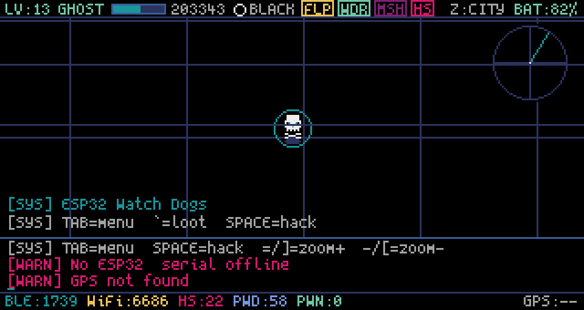
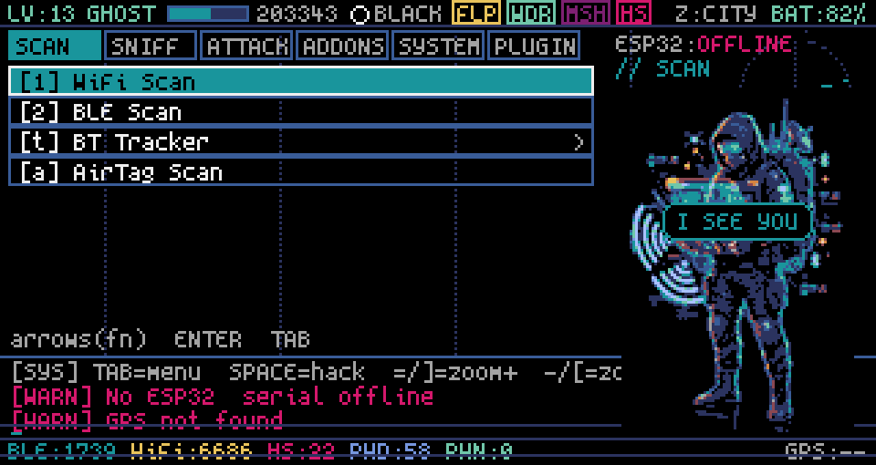

# WatchDogsGo — CardputerZero port

[WatchDogsGo](https://github.com/LOCOSP/WatchDogsGo) — an open-world hacking
RPG that overlays real WiFi/BLE/LoRa/SDR security tooling on a `pyxel`
retro-game frontend, originally built for the ClockworkPi uConsole — ported to
run as an installed app on the **M5Stack CardputerZero** (a pocket Linux
handheld: Raspberry Pi CM0, 320×170 screen, 46-key keyboard).

  
  

## Status

The game runs end-to-end on real hardware: GPS, LoRa/MeshCore (on a Cap with
an SX1262 module), WiFi/BLE wardriving from the device's own radio, and the
WDGWars community portal, and ADS-B/433 MHz with an RTL-SDR dongle all
confirmed live on the device. It launches as **"WatchDogsGo (beta)"** from the
CardputerZero's own app carousel.

It is listed in the **CardputerZero AppStore** (package
`watchdogsgo-cardputerzero`, share code `WDGC`), currently a **beta** — see
[`ROADMAP.md`](ROADMAP.md) for the full phase-by-phase status and what's
verified vs. still open.

## Installing

Install it from the AppStore on the device, or sideload the `.deb` — see
[`docs/install.md`](docs/install.md) for the sideload steps (`scp` the
`.deb`, `dpkg -i`, done) and what works out of the box. ADS-B needs no extra
setup: a RTL-SDR-enabled `readsb` is bundled in the package.

## How it's built

The upstream game code is vendored unmodified (see
[`VENDORED.md`](VENDORED.md) for exact provenance and the upstream re-sync
recipe) and run through a platform layer, `czplatform/`, that adapts it to
this hardware at runtime without editing the vendored code: headless `pyxel`
rendered into the framebuffer, the keyboard read from `evdev`, and the
uConsole-specific GPIO assumptions in the original code neutralized and
re-pointed at this device's own LoRa/GPS pins.

More detail in [`docs/hardware-notes.md`](docs/hardware-notes.md) (pinouts
and measurements), [`docs/ui-adaptation.md`](docs/ui-adaptation.md) (the
640×360 → 320×170 layout work), [`docs/launcher-guidelines.md`](docs/launcher-guidelines.md)
(packaging conventions), [`docs/wifi-monitor-mode.md`](docs/wifi-monitor-mode.md),
and [`docs/portal-rules.md`](docs/portal-rules.md).

## License

MIT. Vendored upstream code is © LOCOSP (see [`LICENSE`](LICENSE)); new code
for this port is under the same license.
